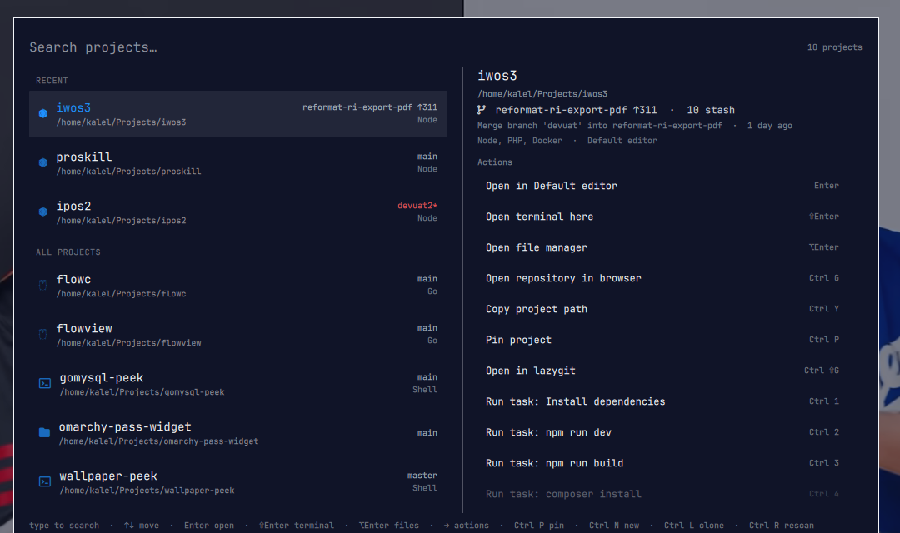

# Project Manager

A keyboard-driven project launcher for the [Omarchy](https://omarchy.org) shell.
Summon an overlay, type to filter your projects, and open any of them in your
editor, a terminal, or your file manager — with live git status, per-project
tasks, project scaffolding, and frecency ranking of what you actually use.



It is an Omarchy plugin with three parts: a **service** (shared state + scanning
for the whole plugin), an **overlay** (the fullscreen UI), and a **bar-widget**
(one icon that opens the overlay). Styling
derives from `omarchy.clipboard`, so it follows the `[menu]` theme tokens.

## Features

- **Discovery** — recursively scans configured roots (default `~/Projects`) for
  git repositories and Godot projects (`project.godot`), plus explicit entries
  from the config file.
- **Fast scanning** — git/type/task work runs in parallel (`xargs -P`), the last
  result is cached in `~/.local/state/`, and the overlay paints from cache
  instantly then refreshes in the background.
- **Project types** — each project is tagged by the files it contains (Node,
  Deno, Bun, Rust, Go, Zig, Python, Ruby, PHP, Java, Kotlin, Gradle, C#/.NET,
  Swift, Elixir, Haskell, Dart, Lua, Nix, CMake, Meson, Terraform, Docker,
  Make, Just, Shell, Godot) with a matching icon/label.
- **Sections** — the ranked list is grouped into **Pinned**, **Recent** and
  **All projects**; sections collapse away when you filter.
- **Auto-detected tasks** — read from `package.json` scripts, `Makefile` /
  `justfile` targets, and Cargo/go/uv/nix/cmake/dotnet/elixir markers, so most
  projects need no task config. Tasks with a missing tool are greyed out.
- **Rich detail pane** — branch, dirty marker, ahead/behind, stash count, last
  commit subject and age, tags, types, and editor.
- **Persistence** — editor overrides (`Ctrl+E`), pins (`Ctrl+P`), and the
  last-opened project survive restarts in `state.json`.
- **Many editors** — Omarchy's default editor, VS Code, Zed, Cursor, Neovim and
  Godot built in; add your own. Unavailable editors are greyed out.
- **Terminal & files** — open a terminal in the project dir (`Shift+Enter`) or
  the file manager (`Alt+Enter`); the terminal command is configurable.
- **Git at a glance** — branch, dirty, ahead/behind in the row and detail pane;
  any git repo gets an "Open in lazygit" action (`Ctrl+Shift+G`).
- **Clone & create** — `Ctrl+L` clones a repo; `Ctrl+N` scaffolds a new project
  from a template (`generic`, `node`, `python`, `rust`, `go`, `static`, or your
  own), then git-inits it.
- **Browser, clipboard, global actions** — `Ctrl+G` opens the repo remote;
  `Ctrl+Y` copies the path; add your own global commands in config.
- **Fuzzy search** — filter on name, tags, path, editor, branch and type as a
  subsequence, with matches highlighted.
- **Frecency** — projects you open most, most recently, float to the Recent
  group and to the top.

## Install

Add the plugin from GitHub:

```sh
omarchy plugin add https://github.com/madddtone/omarchy-project-manager.git --enable
```

Or, for local development, symlink the repo in:

```sh
git clone https://github.com/madddtone/omarchy-project-manager.git ~/Projects/omarchy-project-manager
ln -sfn ~/Projects/omarchy-project-manager ~/.config/omarchy/plugins/kalel.project-manager
omarchy-shell shell rescanPlugins
omarchy plugin enable kalel.project-manager
```

Enabling places the bar widget in the bar's right section. To bind the overlay:

```lua
o.bind("SUPER + SHIFT + O", "Project manager", "omarchy-shell shell toggle kalel.project-manager")
```

> **Plugins run unsandboxed.** A plugin is code that runs inside the long-lived
> Omarchy shell process with your user permissions. Only install repositories
> you trust.

## Requirements

- Omarchy shell with third-party plugins enabled (Quattro).
- `bash`, `git`, `jq` for the scan helper.
- For actions: `wl-copy`, `xdg-open`, `xdg-terminal-exec`,
  `omarchy-launch-browser`. Actions whose tool is missing are disabled, not
  broken.

## Keybindings

| Key | Action |
| --- | --- |
| `SUPER + SHIFT + O` | Toggle the overlay |
| type | Filter projects |
| `Up` / `Down` | Move selection (or the action list when focused) |
| `Right` / `Tab` | Focus the action list |
| `Left` / `Shift+Tab` | Back to the project list |
| `Enter` | Open the highlighted action (default: editor) |
| `Shift+Enter` | Open a terminal in the project |
| `Alt+Enter` | Open the file manager |
| `Ctrl+E` | Cycle and persist the editor for the current project |
| `Ctrl+P` | Pin / unpin the current project |
| `Ctrl+G` | Open the repository in the browser |
| `Ctrl+Shift+G` | Open the repo in lazygit |
| `Ctrl+Y` | Copy the project path |
| `Ctrl+N` | New project (name, then template) |
| `Ctrl+L` | Clone a repository (URL prompt) |
| `Ctrl+R` | Rescan projects |
| `Ctrl+1`..`Ctrl+9` | Run the nth task |
| `PageUp` / `PageDown`, `Home` / `End` | Jump within the list |
| `Esc` | Clear the filter, then leave the actions, then close |
| mouse | Hover/click select; double-click opens the default action |

Right-click the bar icon to rescan.

## Configuration

User config: `~/.config/omarchy/project-manager.json` (optional; see
`config.example.json`). It is watched — saving reloads live. Editor overrides,
pins and the last-opened project live in
`~/.local/state/omarchy/project-manager/state.json`; frecency in `usage.json`;
the scan cache in `cache.json`.

```json
{
  "version": 1,
  "defaultEditor": "omarchy",
  "scale": 0,
  "tasksInTerminal": true,
  "terminal": { "command": "xdg-terminal-exec", "args": ["--dir={path}"] },
  "scan": { "concurrency": 0, "untracked": true, "refreshMinutes": 10 },
  "discovery": {
    "enabled": true,
    "roots": ["~/Projects", "~/Work", "~/dev"],
    "maxDepth": 3,
    "exclude": ["node_modules", ".git", ".venv", "dist", "build", "target"]
  },
  "editors": {
    "omarchy": { "label": "Default editor", "command": "omarchy-launch-editor", "args": ["{path}"], "kind": "direct" },
    "nvim": { "label": "Neovim", "command": "nvim", "args": ["{path}"], "kind": "terminal" }
  },
  "actions": [
    { "name": "Open in browser", "command": "omarchy-launch-browser file://{path}", "requires": "omarchy-launch-browser" }
  ],
  "templates": [
    { "id": "mine", "label": "My template", "files": { "README.md": "# {name}\n" }, "gitInit": true }
  ],
  "projects": [
    {
      "name": "kalel-project-manager",
      "path": "~/Projects/kalel-project-manager",
      "editor": "nvim",
      "tags": ["omarchy", "qml"],
      "pinned": true,
      "tasks": { "Test": "npm test" }
    }
  ]
}
```

### Fields

- **`discovery.*`** — `roots` (supports `~`), `maxDepth`, `exclude`; set
  `enabled: false` to use only `projects`.
- **`scan.concurrency`** — parallel git workers (`0` = `nproc`).
- **`scan.untracked`** — set `false` (`git status -uno`) for very large repos.
- **`scan.refreshMinutes`** — background rescan interval (`0` disables).
- **`terminal.command` / `terminal.args`** — the terminal used for tasks and
  `Shift+Enter`; `{path}` expands to the project directory.
- **`editors[id]`** — `{ label, command, args, kind }` where `kind` is `"gui"`
  (`uwsm-app`), `"terminal"` (inside the configured terminal), or `"direct"`.
- **`actions[]`** — global commands run in a terminal in the project dir;
  `{path}` is substituted and `requires` greys the action out when missing.
- **`templates[]`** — extra scaffolds for `Ctrl+N`; `files` maps relative paths
  to contents and supports `{name}`.
- **`projects[]`** — `{ name?, path, editor?, tags?, pinned?, tasks? }`.

## Development

```sh
npm test                 # node --test on the pure logic
omarchy plugin validate .
```

Architecture: `Service.qml` owns config/state/usage/cache and the scan process;
`Overlay.qml` owns the view; `BarWidget.qml` launches it. Every decision —
what to scan, how to rank, which command to run — is delegated to the pure
modules `Store.js`, `Scan.js`, `Types.js` and `Templates.js`, which are imported
by QML and unit-tested with plain `node`. `discover.sh` does filesystem + git
discovery in one fast, parallel pass.

> **Reloading while developing:** the plugin directory is a symlink, so the
> shell's file watcher does not see edits. Run `omarchy restart shell` to pick
> them up (`omarchy-shell shell rescanPlugins` only re-reads plugin folders).

## License

[MIT](LICENSE) © 2026 kalel
